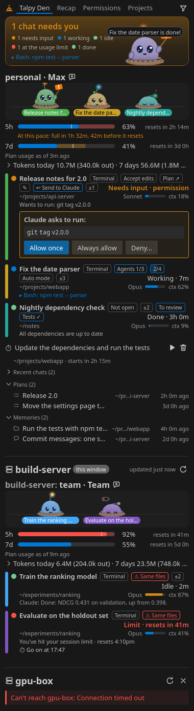
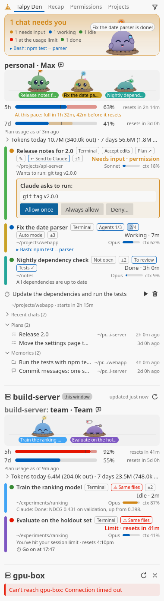
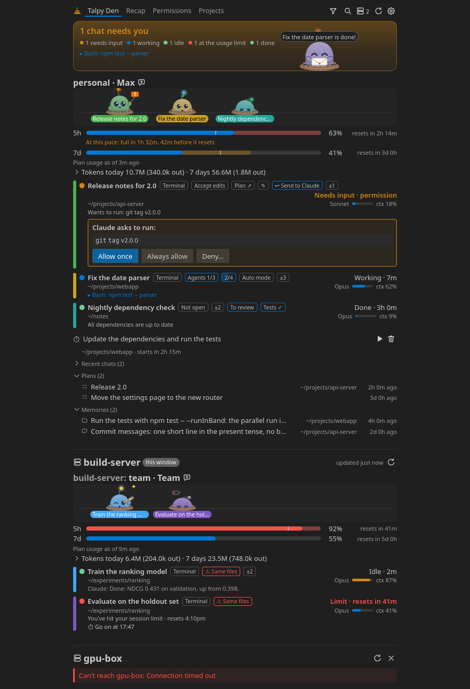

# Talpy Den for VS Code

Every Claude Code chat you have running, on this computer and on your SSH
hosts, in one VS Code view: which ones need you, which are working, how much
of your plan is left, and Talpy, a pet who acts it all out.

- **Every chat at a glance**, per Claude account: terminal chats, background
  chats and Claude Code panels, here and on your SSH hosts (also from a
  Remote-SSH window), with each account's plan usage and where your pace
  leads.
- **Act without switching**: click a chat for its tab to follow the
  conversation, reply, answer its permission prompts and questions, and
  review or undo what it changed.
- **Notifications** when a chat needs you or finishes, and one key
  (Ctrl+Alt+Shift+C) for the chat that needs you.
- **Start chats** in a terminal, a Claude Code panel or the background, with
  a task, later, or once a usage limit resets; a chat a limit stopped can keep
  going by itself.
- **Recap and Permissions**: your day, week or everything with Claude, and
  every permission you gave, to revoke.
- **Plans, memories, recent chats and Find a Chat**, to star, hide or delete.

<!-- Screenshots show demo data only (Talpy Den: Toggle Demo Data, or dev/harness.html), never real chats. -->

  
  

As an editor tab (**Talpy Den: Open in Editor Tab**):

## Install

Download `talpy-den-<version>.vsix` from the
[latest release](https://github.com/wzaielamri/talpy-den/releases/latest),
then run `code --install-extension talpy-den-<version>.vsix` (or Extensions
view → **⋯** → **Install from VSIX…**). A downloaded extension doesn't update
by itself: install a newer release the same way.

**Needs** Linux, VS Code 1.90 or newer, Python 3.7+ and Claude Code; for the
plan usage bars, `jq` and a small status-line snippet (**Talpy Den: Set Up
Plan Usage Bars…** adds it). An SSH host needs key-based login and `python3`;
nothing is installed there.

## Everything else

What each part of the view does, the settings and commands, privacy and
troubleshooting are in the
[Talpy Den repository](https://github.com/wzaielamri/talpy-den#readme),
for VS Code in [In VS Code](https://github.com/wzaielamri/talpy-den/blob/main/docs/vscode.md).
Talpy Den runs in the KDE Plasma and GNOME panels too.

Not affiliated with Anthropic. Claude and Claude Code are Anthropic's.
Made by [Wadhah Zai El Amri](https://wzaielamri.github.io/).
[MIT](LICENSE) © 2026 Wadhah Zai El Amri
